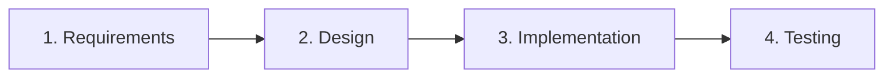
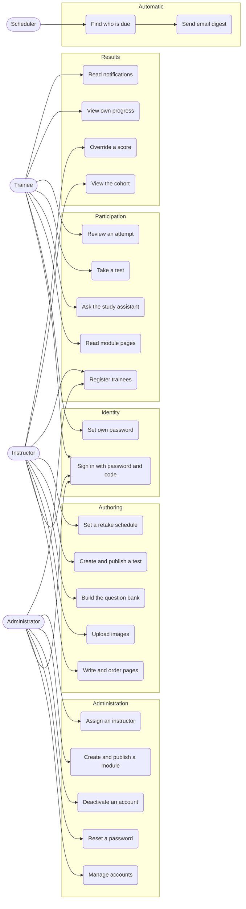
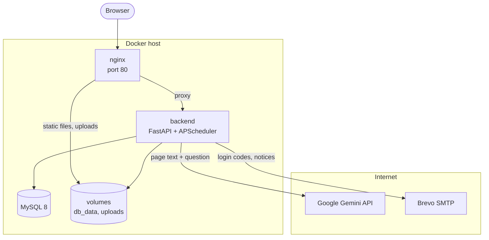
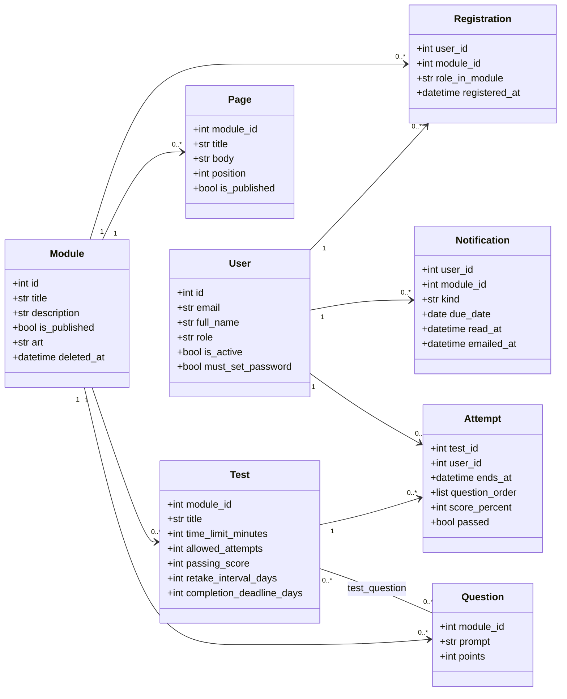
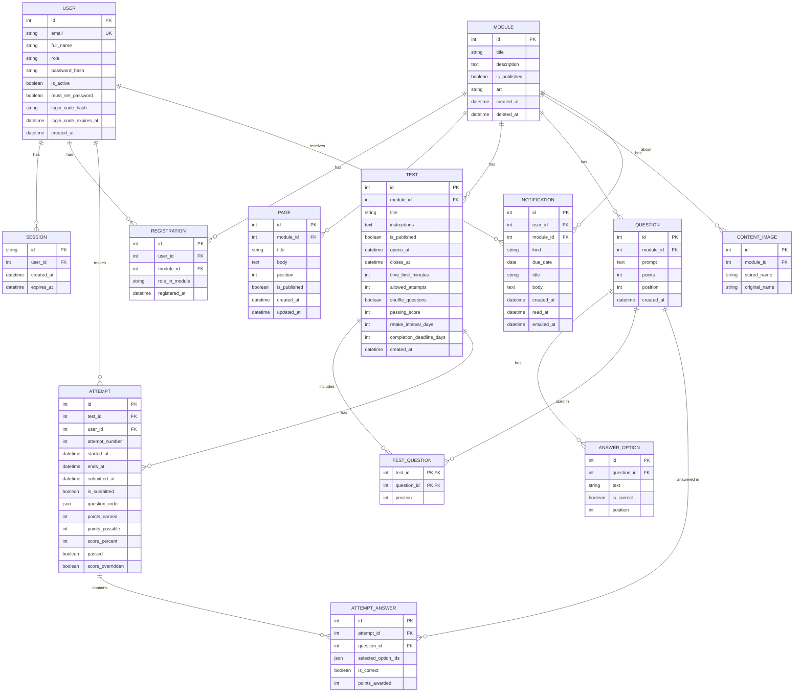
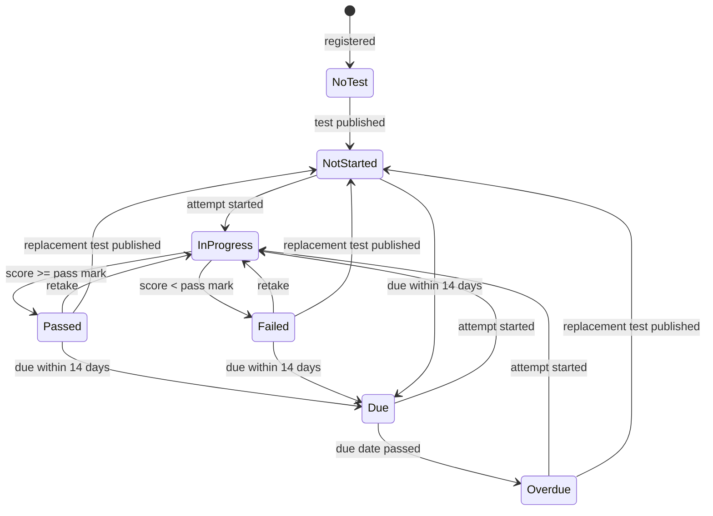
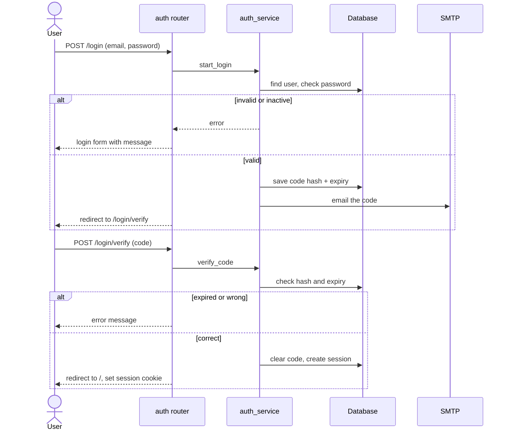
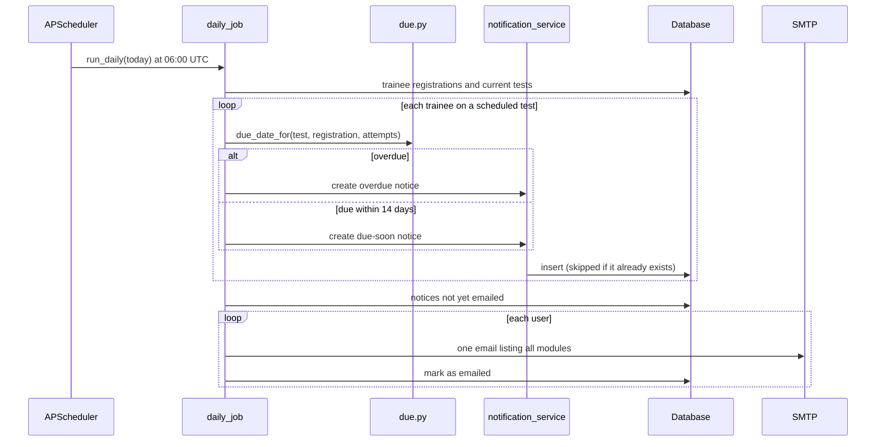
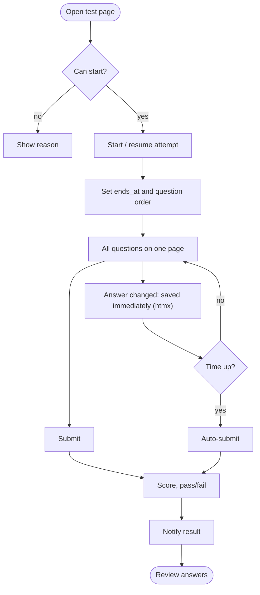
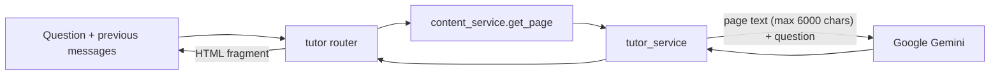

# System Analysis and Design

**SME Cybersecurity Awareness Training Platform**

| | |
|---|---|
| Course | COMP6900 Major Project, University of Newcastle |
| Group | 5 |
| Date | 20 October 2026 |
| Status | Under development and testing |

---

## Contents

1. [Introduction](#1-introduction)
2. [Requirements](#2-requirements)
3. [Architecture](#3-architecture)
4. [Data design](#4-data-design)
5. [Process design](#5-process-design)
6. [Interface design](#6-interface-design)
7. [Implementation](#7-implementation)
8. [Testing](#8-testing)

---

## 1. Introduction

### 1.1 Problem

Small and medium enterprises need to train staff in cybersecurity awareness and
keep a record of who has completed the training and who needs to retake it.

### 1.2 What the system does

- An **administrator** creates accounts and modules and assigns instructors.
- An **instructor** writes module pages, builds a question bank and creates a
  test by choosing how many questions it has; the questions are drawn at random
  from the bank.
- A **trainee** reads the pages, takes the test and sees their results.
- A **daily job** works out who is due for retraining and notifies them.

### 1.3 Out of scope

- Self-registration
- Assignments, forums, messaging and calendars
- SCORM / xAPI import
- Notification preferences
- Multiple organisations in one installation
- Certificates and badges

### 1.4 Development model

The project follows the **waterfall model**:



| Stage | Output | Section |
|---|---|---|
| 1. Requirements | Actors, use cases, functional and non-functional requirements | §2 |
| 2. Design | Architecture, data, processes, interface | §3 to §6 |
| 3. Implementation | The application | §7 |
| 4. Testing | Automated test suite | §8 |

Requirements are grouped and built in this order:

| Group | Covers |
|---|---|
| P0 Foundation | Accounts, two-step login, sessions, roles |
| P1 Modules and content | Modules, pages, images, registration |
| P2 Tests | Question bank, tests, attempts, scoring |
| P3 Results | Progress state, dashboards, cohort view |
| P4 Scheduling | Retake intervals, daily job, notifications |

---

## 2. Requirements

### 2.1 Actors

| Actor | Description |
|---|---|
| Administrator | Creates accounts and modules, publishes modules, assigns instructors |
| Instructor | Manages the modules they are assigned to |
| Trainee | Reads content and takes tests |
| Scheduler | Automatic daily process that sends due and overdue notices |

A user's role on a module (`registration.role_in_module`) is separate from their
platform role, so one person can be an instructor on one module and a trainee on
another.

### 2.2 Use case diagram



### 2.3 Key functional requirements

**Access**
- Accounts are created only by an administrator.
- Login needs a password and a 6-digit code sent by email.
- A new account must set its own password before using the platform.
- Deactivating an account takes effect on the next request.

**Content and tests**
- Only assigned instructors can edit a module's content.
- A test cannot be edited once it has attempts.
- The time limit is enforced on the server.
- An expired attempt is submitted automatically the next time it is loaded.

**Results and scheduling**
- The most recent attempt decides a trainee's result.
- Results and due dates are calculated, not stored.
- A new trainee gets a full interval from their registration date.
- An overdue notice is sent once.
- Running the daily job twice on the same day creates no duplicates.

### 2.4 Non-functional requirements

| Attribute | Requirement |
|---|---|
| Deployment | Runs with `docker compose up` (three containers) |
| Offline assets | Bootstrap, icons, fonts, htmx and Quill are served locally |
| Accessibility | WCAG AA text contrast |
| Responsive | Works on phone, tablet and desktop |
| Data integrity | Unique constraints enforced by the database |

---

## 3. Architecture

### 3.1 Layers

A server-rendered web application in three tiers (browser, application,
database). The application is split into layers:

| Layer | Responsibility |
|---|---|
| Routers | Read the request, call a service, render a template |
| Services | Business logic and access checks |
| Models | Database tables (SQLModel) |
| Schemas | Read models for templates and input validation |

Modules a user cannot access return **404**.

### 3.2 Deployment diagram



Only nginx exposes a port. The backend and database are reachable only inside
the Docker network. The daily scheduler runs inside the backend process.

### 3.3 Class diagram



### 3.4 Services

| Service | Responsibility |
|---|---|
| `auth_service` | Login, codes, sessions |
| `admin_service` | Accounts |
| `module_service` | Modules and module access checks |
| `content_service` | Pages, ordering, images |
| `registration_service` | Adding and removing users on modules |
| `question_service` | Question bank |
| `test_service` | Tests and random question selection |
| `attempt_service` | Taking, submitting and reviewing attempts |
| `scoring` | Score, percentage, pass/fail |
| `state` | A trainee's state on a module |
| `due` | Due date calculation |
| `results_service` | Dashboards and cohort views |
| `notification_service` | Creating and sending notifications |
| `email_service` | Sending email |
| `daily_job` | The daily scheduled run |
| `tutor_service` | Study assistant (Gemini) |

---

## 4. Data design

### 4.1 Entity relationship diagram



### 4.2 Tables

13 tables. Unique constraints:

| Table | Unique constraint |
|---|---|
| `user` | `email` |
| `registration` | `(user_id, module_id)` |
| `page` | `(module_id, position)` |
| `test_question` | `(test_id, question_id)` (primary key) |
| `attempt_answer` | `(attempt_id, question_id)` |
| `notification` | `(user_id, kind, module_id, due_date)` |

### 4.3 Calculated values

These are calculated when needed and not stored:

| Value | Calculated from |
|---|---|
| Trainee state on a module | Registration, current test, attempts |
| Due date | Retake interval and latest attempt |
| Test locked | Whether any attempt exists |
| Results | Attempts |

Tables are created at startup with `create_all()`.

### 4.4 Initial content

Four training modules are loaded at startup from
`backend/app/seed_content/training_content.json`. Each module has 6 pages, a
20-question bank and an end-of-module quiz (10 questions, 70% pass mark, 2
attempts). Modules that already exist are skipped. Demo accounts are created
separately with `seed.py`.

---

## 5. Process design

### 5.1 Trainee state

Each trainee has one state per module, calculated by `state.py`:



- The **latest** attempt decides the state. Example with an 80% pass mark:
  40%, 90%, then 70% = Failed.
- Publishing a replacement test resets everyone to Not started. The instructor
  sees how many people will be affected before publishing.

### 5.2 Two-step login



Codes expire after 10 minutes and a new login replaces any previous code.
Sessions last 12 hours.

### 5.3 Daily job



Failed emails are retried on the next run.

### 5.4 Taking a test



- A test's questions are picked at random from the bank when the test is saved.
  Saving again with the same count keeps the same questions.
- `shuffle_questions` changes the question order for each attempt.
- `allowed_attempts` of 0 means unlimited; on recurring tests the limit resets
  after a pass.

### 5.5 Study assistant



- The page text and the question are sent to Google.
- Nothing is stored; the conversation is kept in the page (last 6 exchanges).
- Only pages the user can access can be used.
- The feature is hidden when no API key is set.

---

## 6. Interface design

- Server-rendered Jinja2 templates with Bootstrap 5.3.
- htmx is used for saving test answers and for the study assistant.
- Quill is used as the page editor.
- One stylesheet with design tokens (colours, type scale, spacing); see
  `docs/design-system.md`.
- Light and dark theme, following the OS setting.
- Dashboards show summary figures (modules, published, drafts for staff; to do,
  completed, overdue for trainees).
- Module cards show a coloured cover or an uploaded image, and the trainee's
  state.
- Times are stored in UTC and shown in the user's local time zone.

**Accessibility**

| Item | Implementation |
|---|---|
| Text contrast | At least 4.5:1 |
| Focus | Visible focus outline |
| Touch targets | 44px minimum |
| State badges | Always show a text label |
| Reduced motion | Transitions disabled when requested |
| Text size | All sizes in rem |

---

## 7. Implementation

### 7.1 Technology

| Component | Choice |
|---|---|
| Language | Python 3.12 |
| Web framework | FastAPI, Jinja2 |
| ORM | SQLModel |
| Database | MySQL 8 (utf8mb4) |
| Web server | nginx 1.27 |
| Front end | Bootstrap 5.3, Bootstrap Icons, Inter, htmx, Quill |
| HTML sanitising | nh3 |
| Password hashing | Argon2 |
| Scheduling | APScheduler |
| Email | Brevo SMTP |
| Study assistant | Google Gemini (optional) |

### 7.2 Code structure

| Folder | Contents |
|---|---|
| `backend/app/models/` | 13 tables |
| `backend/app/schemas/` | Read and input models |
| `backend/app/services/` | 16 services |
| `backend/app/routers/` | 12 routers, 65 routes |
| `backend/app/templates/` | 35 templates, 4 email templates |

Shared modules: `config.py` (settings from `.env`), `security.py` (hashing, CSRF,
rate limiting), `dependencies.py` (login and role checks), `rendering.py`,
`sanitise.py`, `art.py`, `content_seed.py`.

### 7.3 Routes

| Area | Router | Routes |
|---|---|---|
| Login and password | `auth`, `password` | 7 |
| Accounts | `admin` | 7 |
| Modules | `modules` | 11 |
| Content | `content` | 10 |
| Registration | `registrations` | 3 |
| Questions | `questions` | 6 |
| Tests | `tests` | 7 |
| Attempts | `attempts` | 7 |
| Results | `results` | 4 |
| Notifications | `notifications` | 2 |
| Study assistant | `tutor` | 1 |
| **Total** | | **65** |

---

## 8. Testing

**659 automated tests** in 57 files, run with pytest against MySQL 8 in a
separate test database. Each test runs in a transaction that is rolled back.

| Type | Covers |
|---|---|
| Unit tests | `scoring`, `state`, `due`, `art` |
| Service tests | Access checks, test locking, daily job, notifications |
| Route tests | Status codes, role access, CSRF, page content |
| Structure tests | Routers contain no queries; templates receive only read models |

Run the tests with:

```bash
docker compose exec backend pytest
```
